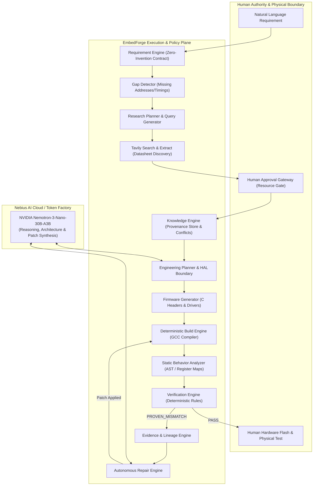

# EmbedForge

[](LICENSE)
[](pyproject.toml)
[](https://studio.nebius.ai/)
[](https://tavily.com/)

> **EmbedForge** is an autonomous, evidence-driven AI embedded engineering system. It transforms human embedded-system requirements into verified, buildable firmware through bounded technical research, human-in-the-loop truth promotion, deterministic behavior extraction, rule-based verification, and autonomous repair loops.

---

## 1. System Architecture

Unlike simple prompt-to-code chatbots, EmbedForge operates as an **autonomous closed-loop engineering pipeline**:



---

## 2. Core Non-Negotiable Principles

1. **Human Authority**: The human engineer decides which external resources become trusted engineering knowledge.
2. **Zero Invention Contract**: The Requirement Engine never invents MCU models, I2C addresses, sampling frequencies, register offsets, pin mappings, or voltages. If missing, they are flagged as `InformationGap` items.
3. **Deterministic Verification**: LLMs provide reasoning, while deterministic parsers and AST extractors extract actual code behavior and verify against approved facts.
4. **Complete Traceability**: Every finding, claim, and patch has an end-to-end lineage trail (`REQ-xxx` $\rightarrow$ `RES-xxx` $\rightarrow$ `KNOW-xxx` $\rightarrow$ `PLAN-xxx` $\rightarrow$ `FW-xxx` $\rightarrow$ `BUILD-xxx` $\rightarrow$ `BEHAV-xxx` $\rightarrow$ `FIND-xxx` $\rightarrow$ `CASE-xxx` $\rightarrow$ `PATCH-xxx`).
5. **Physical Hardware Boundary**: Physical flashing and testing remain under human control.

---

## 3. Technology Stack & Integrations

### A. Nebius Token Factory & NVIDIA Nemotron
- **Model**: `nvidia/NVIDIA-Nemotron-3-Nano-30B-A3B`
- **Endpoint**: `https://api.studio.nebius.ai/v1`
- **Role**: High-reasoning cognitive brain for:
  - Engineering architecture planning and HAL interface partitioning.
  - Root-cause reasoning over verification evidence cases.
  - Minimal patch synthesis.

### B. Tavily Search & Extract Integration
- **Role**: Automated, bounded discovery of official datasheets, register maps, and silicon errata.
- **Features**:
  - Domain-scoped searches prioritizing official semiconductor manufacturers (`st.com`, `ti.com`, `invensense.tdk.com`, `bosch-sensortec.com`, `nordicsemi.com`).
  - Automated extraction of register addresses (`WHO_AM_I`, `PWR_MGMT_1`, `SMPLRT_DIV`), maximum bus clock speeds, and startup delays.
  - Human review gateway ensuring no third-party snippet is promoted to the Knowledge Base without approval.

---

## 4. Reference Repositories (Study, Don't Clone)

| Repository | Focus Area | Architectural Pattern Studied |
| :--- | :--- | :--- |
| [NVIDIA NeMo Agent Toolkit](https://github.com/NVIDIA/NeMo-Agent-Toolkit) | Orchestration & Tools | Policy-governed tool execution sandboxing |
| [NVIDIA Nemotron](https://github.com/NVIDIA-NeMo/Nemotron) | Reasoning Brain | Structured tool calling and reasoning recipes |
| [Embedded AI Workspace](https://github.com/atillab1/embedded-ai-workspace) | Firmware QA & MCP | Datasheet tooling, static analysis, and HIL validation |
| [LUXAR](https://github.com/neltharion11/luxar-embedded-agent) | Autonomous Agent Loop | Embedded lifecycle loop and human approval gates |
| [Datasheet-to-Driver](https://github.com/livia0194/datasheet-to-driver) | Knowledge Extraction | Converting structured register tables into HAL drivers |
| [Embedder CLI](https://github.com/embedder-dev/embedder-cli) | Build & Debug Agent | Deterministic log parsing and iterative compilation |

---

## 5. Quickstart & Installation

### Prerequisites
- Python 3.10+ (tested on Python 3.14)
- Git & Virtualenv

### Installation

```bash
# Clone the repository
git clone https://github.com/your-username/embedforge.git
cd embedforge

# Create and activate virtual environment
python -m venv .venv
source .venv/bin/activate  # On Windows: .\.venv\Scripts\activate

# Install EmbedForge in editable mode
pip install -e .

# Optional: datasheet PDFs -> Markdown (headings, tables, reconstructed equations; PyMuPDF is AGPL-3.0)
pip install -e ".[pdf]"
```

### Environment Configuration

Copy `.env.example` to `.env` and fill in your keys (`.env` is git-ignored — never commit it):

```ini
# Claude API (Anthropic): when set, runs use Claude instead of Nemotron
ANTHROPIC_API_KEY=
# Google Gemini API (Google AI Studio key): used when no Claude key is set
GEMINI_API_KEY=
# EMBEDFORGE_PROVIDER=anthropic   # or gemini / nebius / nvidia, to force one provider

# Nebius AI Cloud / Token Factory
NEBIUS_API_KEY=your_nebius_api_key_here
NEBIUS_BASE_URL=https://api.studio.nebius.ai/v1
NEBIUS_MODEL=nvidia/NVIDIA-Nemotron-3-Nano-30B-A3B   # default; change per project in the UI

# Optional second provider: NVIDIA API catalog / NIM (https://build.nvidia.com)
NVIDIA_API_KEY=

# Tavily AI Search (required for live datasheet research)
TAVILY_API_KEY=your_tavily_api_key_here
```

### Choosing the model

The model picker in the top bar lists every chat model your provider(s) offer, NVIDIA Nemotron models first,
with their size parsed from the model id (e.g. `30B · 3B active`). The choice is saved per project.
Small active-parameter models (such as Nemotron 3 Nano, 3B active) tend to loop in research on long
firmware tasks; larger ones (Nemotron 3 Super / Ultra) follow the research → code → build → verify loop
more reliably.

---

## 6. Running EmbedForge

### Run Nominal Autonomous Engineering Pipeline
```bash
python -m embedforge.cli --prompt "Create an STM32 driver for MPU6050 accelerometer over I2C at 100Hz with 30ms startup delay." --inject-defect NONE
```

### Run Autonomous Verification & Repair Loop
Inject a known hardware mismatch (e.g. incorrect I2C address `0x77` instead of datasheet `0x68`) to observe autonomous detection, evidence building, patching, and reverification:
```bash
python -m embedforge.cli --inject-defect WRONG_I2C_ADDRESS
```

### Launch Interactive Web Dashboard & Control Plane
Run the local FastAPI dashboard:
```bash
python -m embedforge.server
```
Then navigate to **`http://localhost:8000`** in your browser:
* **Pipeline stepper** — Understand → Target → Research → Facts → Code → Build → Verify → Deliver, live per run.
* **Run health** — tool-call breakdown and a plain-language diagnosis of where a run stalled
  (e.g. "Stuck in research: 9 searches but no facts recorded").
* **Conversation** with tool calls grouped into readable activity blocks, guard warnings and ask-user cards.
* **Workspace** — files with FACT-tag links and error-line marks, the fact ledger, sources with trust tiers,
  versioned builds (.hex/.bin/.elf), checks (compiler + datasheet verification + traceability) and a terminal.
* Model picker, Strict / Fast / Custom prompt modes, light & dark themes, responsive down to phone width.

### Import your schematic from EasyEDA

Click **EasyEDA** in the composer (or *Import EasyEDA schematic* in the left rail) and drop your exports:

| Editor | Best file | Optional extras |
|---|---|---|
| EasyEDA Pro | `File › Save As (Local)` → `.epro` (V2) or `.epro2` (V3) | `File › Export › Netlist` (Protel2 / PADS), `File › Export › Bill of Materials` (CSV) |
| EasyEDA Standard | `File › EasyEDA File Source…` → `.json`, or right-click the project › `Download` (`.zip`) | `File › Export Netlist` (Protel/Altium / PADS), BOM CSV |

KiCad netlists (`.net`) work too. Files are recognised by content, stored under `schematics/`, and merged into one
board model: netlists give connectivity, the schematic source gives pin names (`PA8`…), the BOM gives part numbers.
The **Board** tab shows the MCU pin map; the agent reads it with the `query_board` tool and records each pin it relies
on as a Fact Ledger entry quoting the exact connectivity line (e.g. `U1 pin 29 (PA8) -> net HIN_A -> U2.3 (HIN1)`),
so wiring in the firmware is traceable to your schematic. The agent cannot write to `schematics/`.

### Build targets

| Firmware | How it builds | Notes |
|---|---|---|
| Custom firmware (STM32, ESP32, AT32, RP2040, …) | PlatformIO, project-local core | Boards from the PlatformIO registry; ArteryTek AT32 platform auto-installed |
| Custom firmware for RP2350 / RP2354 | PlatformIO + community platform [`maxgerhardt/platform-raspberrypi`](https://github.com/maxgerhardt/platform-raspberrypi) (Arduino-Pico core) | Not official PlatformIO support. RP2354A/B = RP2350A/B with 2 MB stacked flash: use an RP2350B board such as `weact_rp2350b` with `board_upload.maximum_size = 2097152` |
| Betaflight board configs | Betaflight `2026.6.2` checkout + its own toolchain, built in **WSL** (`make CONFIG=<BOARD>`) | One-time setup in `~/.embedforge` (no sudo): Betaflight, Arm GCC 13.3.1, portable CMake, Pico SDK, picotool, official reference configs. The agent writes `betaflight/configs/CUST/<BOARD>/config.h` from the imported schematic; every pin is verified against the schematic **and** against the RP2350 peripheral pin tables. RP2354 flash size (2 MB) is set by a generated `config.mk` / `pico_flash_mem.ld` |
| INAV | not supported here | Official INAV targets are STM32F4/F7/H7 and AT32F435; INAV 10.0 pre-releases add an experimental, bench-test-only RP2350A target. An RP2350B/RP2354B port is a separate engineering project |

### Agent guard-rails

* **No fake targets.** MCUs are resolved against the real PlatformIO registry. Official vendor platforms that are
  not in the default registry (currently ArteryTek AT32 → `arterytekat32` / `at32firmlib`) are installed
  automatically from an allow-list; anything else is reported as unsupported rather than built for another chip.
* **SDK first.** `init_project` downloads the toolchain and SDK immediately so the agent can look up real SDK
  function names before writing code.
* **Progress guard.** More than 6 searches (or 10 SDK lookups) without recording a fact or changing code blocks
  further searching with a concrete next step; 14 idle steps trigger a nudge and 28 pause the run for your input.
* **Build sandbox policy.** The agent cannot write `extra_scripts`, `platform_packages`, `!command` flags,
  URL `lib_deps`, `*.py` or `library.json` — the ways a PlatformIO build can execute code on your machine.

---

### Run Benchmark Scorecard Evaluation
```bash
python -m embedforge.benchmark.runner
```

---

### Run Test Suite
```bash
pytest -v
```

---

## 7. License

EmbedForge is open-source software licensed under the [Apache License 2.0](LICENSE).
