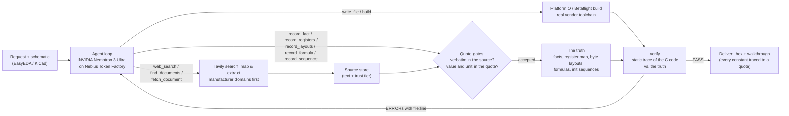

# EmbedForge

[](LICENSE)
[](pyproject.toml)
[](https://tokenfactory.nebius.com/)
[](https://tavily.com/)

**EmbedForge turns a component's datasheet into a checked specification, has an AI agent write the driver, and
catches datasheet-level bugs in that driver before any board or simulator exists.**

An NVIDIA Nemotron agent researches the datasheet (with Tavily), records what it needs as facts that must be quoted
word for word from the source, writes the firmware and compiles it with the real vendor toolchain. Then `verify`
reads the C code without running it, works out exactly what it would send to the chip, and compares that with the
recorded datasheet facts. Any difference is an error with a file and line, and goes back to the agent to fix.

---

## Why

Driver bugs that come from misreading a datasheet — the wrong byte order of a calibration value, a reserved bit
set in a config register, a reset delay that is too short, a measurement enabled before the chip is configured —
compile cleanly and usually surface on the bench, with a logic analyser, days later. AI coding agents make exactly
these mistakes, and confidently. Other agents for firmware check their output by flashing a board or running a
circuit simulator. EmbedForge checks it against the datasheet itself, statically, so these bugs are caught at the
desk.

## How it works



1. **Research.** `web_search` runs a Tavily search (manufacturer domains preferred, full page kept as Markdown);
   `find_documents` maps a vendor's product page with Tavily Map to find its official datasheet and errata;
   `fetch_document` reads web pages with Tavily Extract and converts PDFs to Markdown locally (tables and equations
   kept). Sources get a trust tier: manufacturer domains and official GitHub organisations are authoritative; forums
   and mirrors are recorded but flagged.
2. **The truth layer.** Every fact the firmware relies on is recorded with a quote. A fact is accepted only if the
   quote appears verbatim in the stored source (ignoring layout, case and quote marks, on word boundaries), the value
   appears inside the quoted text, and its unit matches the one the source states. Register maps (fields and named
   values), byte layouts, burst-read rules, conversion formulas and datasheet init sequences are recorded the same
   way. Pins come from the imported schematic, quoting its connectivity lines.
3. **Build.** The agent writes the firmware and builds it with PlatformIO (or Betaflight's own build in WSL).
4. **Verify.** A static tracer (`embedforge/truth/flow.py`) walks the code from its entry points — pico-sdk, Arduino
   Wire/SPI, STM32 HAL, ESP-IDF (new and legacy drivers) and Zephyr bus calls; macros, structs, register tables,
   pointers, FreeRTOS tasks and delays — and records the bus traffic: `write 0x7E <- 0xB6`, `delay 2000 us`,
   `read 0x31 x21`. `verify` compares that trace with the truth:

| Compared | Bug it catches | Error code |
|---|---|---|
| Constants vs. facts | A made-up or untagged address, register or chip ID | `UNSOURCED_CONSTANT`, `FACT_VALUE_MISMATCH` |
| Register writes vs. register map | A register the map does not have; a reserved bit set | `REG_UNMAPPED`, `REG_RESERVED_BITS` |
| Event order vs. init sequence | Measurement enabled before configuration; a missing reset | `FLOW_ORDER`, `FLOW_STEP_MISSING` |
| Written values vs. sequence | Forced mode written where normal mode is required | `FLOW_VALUE_MISMATCH` |
| Waits vs. required time | `vTaskDelay(pdMS_TO_TICKS(2))` at 100 Hz waits 0 ticks | `FLOW_DELAY_SHORT` |
| Byte assembly vs. layout | MSB and LSB swapped | `LAYOUT_SHIFT` |
| Burst reads vs. datasheet | Data registers read in two transactions | `REG_BURST_SPLIT` |
| Code math vs. formula (run on probe register bytes) | 2^30 mistyped, exponent sign flipped, wrong signedness | `FORMULA_MISMATCH`, `FORMULA_MISSING` |
| Code it cannot follow | A bus call the tracer does not model | `FLOW_OPAQUE_BUS` |

Code that verify cannot check fails; it never passes silently. The IDE shows the evidence: every constant traced
to its fact and quote, each datasheet sequence step by step, and each register write decoded into its fields.

## Does verify work? The benchmark

`embedforge/verifybench` checks the checker, with no LLM involved. It uses a fictional barometer, the DM388 (a
datasheet written for the benchmark, so the right answer is known exactly), records its truth through the same
gates the agent uses, and verifies a correct driver written for 9 frameworks and in 21 C styles, plus the same
drivers with one planted bug each:

| Measure | Result |
|---|---|
| Correct drivers passing | 30 of 30 |
| Planted bugs caught (one per run) | 615 of 615 |
| Code verify cannot check, blocked instead of passed | 6 of 6 |

With zero misses in 615 runs, the 95% upper bound on the miss rate for bugs of these kinds is about 0.5% (rule of
three, 3/n). Run it yourself — it is offline and free:

```bash
python -m embedforge.verifybench          # add -v to list every planted bug and the error that caught it
```

## NVIDIA Nemotron on Nebius Token Factory

- **Default model:** `nvidia/Nemotron-3-Ultra-550b-a55b` on Nebius Token Factory (OpenAI-compatible API). In our
  runs the larger Nemotron models (Super, Ultra, 3.5 Lightning) reached verified Betaflight board configs, while
  Nano (3B active) looped in research. The model picker lists every chat model the provider offers, Nemotron first.
- **Sampling and chat template** follow the Nemotron 3 model card: temperature 1.0, top_p 0.95, and
  `chat_template_kwargs = {enable_thinking: true, force_nonempty_content: true}`, NVIDIA's setting for coding agents
  and tool calling (`EMBEDFORGE_NEMOTRON_EFFORT=medium` adds `medium_effort` for shorter reasoning; a provider that
  rejects the options is used without them). Replies get up to 16k output tokens; reasoning arrives in
  `reasoning_content` (or inline `<think>`) and is shown live in the IDE.
- **Tool calling** uses the OpenAI `tools` schema. Calls the model writes as text (Qwen-coder XML, Hermes JSON or
  bare JSON) are recovered and run; replies cut off at the token limit are retried instead of shown.
- **Your own GPUs:** [`deploy/nebius-vm/`](deploy/nebius-vm/README.md) serves Nemotron 3 Super with vLLM on a Nebius
  AI Cloud GPU VM (`SELFHOSTED_BASE_URL`) and runs the IDE next to it, reachable from any browser with a password.
- **Provider order:** self-hosted → Nebius Token Factory (Nemotron) → NVIDIA API catalog (Nemotron) → Claude →
  Gemini, whichever is configured first; `EMBEDFORGE_PROVIDER` forces one.

## Tavily: it finds, the ledger verifies

Every fact EmbedForge relies on is quoted from text Tavily found, mapped or extracted, so Tavily is the start of the
evidence chain:

| Step | Tavily endpoint | How it is used |
|---|---|---|
| Find | **Search** (`search_depth="advanced"`, `chunks_per_source=3`) | Manufacturer domains preferred (`include_domains_mode="prefer"`), quoted part numbers matched exactly (`exact_match`), the whole page kept as Markdown (`include_raw_content="markdown"`) so register tables stay tables and every quote can be checked against it; relevance `score` passed to the agent |
| Discover | **Map** (`instructions`, `max_depth=2`, no external links) | `find_documents` maps the part's product page for the vendor's own datasheet, reference manual, register map and errata, PDFs and the part's own documents first |
| Read | **Extract** (`extract_depth="advanced"`, `format="markdown"`) | Web pages are read through Extract (rendered, tables kept); PDFs are converted locally first, Extract as the fallback |
| Verify | — | The fact ledger accepts a fact only if its quote is verbatim in that stored text |

Every call asks for its usage (`include_usage`) and is logged with its `request_id` and credits, and each stored
source keeps the endpoint and request that produced it. The IDE shows them per source, and the delivery walkthrough
lists, for every fact, the Tavily request that found its source and the credits spent per datasheet fact. Searches
are cached per run, and a research budget stops endless searching (6 searches without a new fact or code change).
`TAVILY_SEARCH_DEPTH=basic` halves the search cost.

## Quickstart

Requirements: Python 3.10+. PlatformIO is installed as a dependency and downloads each project's toolchain on first
use. Betaflight builds need Windows with WSL (Ubuntu).

```bash
git clone https://github.com/Toy-tusk7/embedded_force.git
cd embedded_force
python -m venv .venv
source .venv/bin/activate          # Windows: .\.venv\Scripts\activate
pip install -e .
pip install -e ".[pdf]"            # optional: better PDF -> Markdown (PyMuPDF, AGPL-3.0)
cp .env.example .env               # then add NEBIUS_API_KEY and TAVILY_API_KEY
embedforge                         # or: python -m embedforge.server
```

To host the IDE for others (a demo on a cloud VM), set `EMBEDFORGE_PASSWORD` and `EMBEDFORGE_HOST=0.0.0.0`: the
browser asks for the password (any user name), and the server refuses to listen beyond the local machine without one.

Open **http://localhost:8000** and describe the firmware, e.g. *"Raspberry Pi Pico (pico-sdk), BMP388 on I2C0
(SDA GP4, SCL GP5, SDO to GND): read temperature and pressure every second over USB serial."*

### The IDE

- **Pipeline** — Understand → Target → Research → Facts → Code → Build → Verify → Deliver, live per run, with a run
  health panel that says where a run is stuck.
- **Conversation** — the agent's reasoning and tool calls, grouped into readable activity blocks.
- **Workspace** — files (FACT tags link to their quote), the fact ledger with quotes and trust tiers, sources,
  versioned builds (`.hex` / `.bin` / `.elf`), Checks (compiler errors, verify findings, sequences, register meaning,
  traceability) and a terminal.

### Import your schematic

Click **EasyEDA** in the composer and drop your exports:

| Editor | Best file | Optional extras |
|---|---|---|
| EasyEDA Pro | `File › Save As (Local)` → `.epro` / `.epro2` | `File › Export › Netlist`, `File › Export › Bill of Materials` (CSV) |
| EasyEDA Standard | `File › EasyEDA File Source…` → `.json`, or the project `.zip` | `File › Export Netlist`, BOM CSV |

KiCad netlists (`.net`) work too. Netlists give connectivity, the schematic gives pin names, the BOM gives part
numbers. The agent reads the board with `query_board` and records each pin it uses as a fact quoting the exact
connectivity line (e.g. `U1 pin 29 (PA8) -> net HIN_A -> U2.3 (HIN1)`).

### Build targets

| Firmware | How it builds | Notes |
|---|---|---|
| Custom firmware (STM32, ESP32, AT32, RP2040, …) | PlatformIO, project-local core | Boards from the PlatformIO registry; ArteryTek AT32 installed automatically |
| Custom firmware for RP2350 / RP2354 | PlatformIO + [`maxgerhardt/platform-raspberrypi`](https://github.com/maxgerhardt/platform-raspberrypi) | Community platform; RP2354A/B = RP2350A/B with 2 MB stacked flash |
| Betaflight board configs | Betaflight `2026.6.2` + its toolchain in **WSL** (`make CONFIG=<BOARD>`) | The agent writes `config.h` from the schematic; every pin is checked against the schematic and the RP2350 pin tables |

### Guard-rails

- **No fake targets.** MCUs are resolved against the real PlatformIO registry; anything else is reported as
  unsupported rather than built for another chip.
- **Budgets that follow progress.** 6 searches or 10 SDK lookups without a new fact or code change block further
  searching with a concrete next step; a run gets 60 steps, extended by 30 (up to 3 times) while it is still making
  progress, and pauses after 28 steps without progress.
- **Build sandbox.** The agent cannot write `extra_scripts`, `platform_packages`, `!command` flags, URL `lib_deps`,
  `*.py` or `library.json` — the ways a PlatformIO build can run code on your machine.

## Project layout

| Path | What it does |
|---|---|
| `embedforge/agent/` | The agent loop (`loop.py`), model providers (`llm.py`), tools (`tools.py`), context and prompts |
| `embedforge/truth/` | Sources and PDF → Markdown, the fact ledger, register/sequence books, the static tracer (`flow.py`) and `verifier.py` |
| `embedforge/toolchain/` | PlatformIO and Betaflight (WSL) builds, `.hex` / `.uf2` output |
| `embedforge/eda/` | EasyEDA / KiCad schematic import |
| `embedforge/verifybench/` | The verify benchmark (fictional DM388 datasheet, drivers, planted bugs) |
| `embedforge/server.py`, `embedforge/web/` | FastAPI server and the browser IDE |
| `tests/` | `pytest` (offline: models and Tavily are faked) |

## Limits

Verify replaces neither a first power-on test nor a logic analyser. It cannot see electrical faults (wiring,
pull-ups, power, noise, a dead chip), bus-level timing (clock stretching, signal integrity), or chip behaviour the
datasheet does not describe (errata). It is only as good as the recorded facts — which is why every fact must be
quoted verbatim, and why a missing fact makes verify fail instead of guess. The static tracer follows the SDK calls
listed above; other bus calls are reported, not trusted.

## Related work

Agents that write firmware and test it on a board ([Embedder](https://www.ycombinator.com/companies/embedder),
[EmbedGenius](https://arxiv.org/abs/2412.09058)) or in a circuit simulator ([EmbedBench](https://arxiv.org/abs/2506.11003)),
and formal tools that prove general properties from hand-written specifications (CBMC, Frama-C, Microsoft SDV).
EmbedForge's difference: the specification is built from the datasheet by the agent, every line of it checked
against the source text, and the code is checked against it before anything runs.

## Tests

```bash
pip install -e ".[dev]"
pytest                                  # offline: models and Tavily are faked
python -m embedforge.verifybench        # the verify benchmark
```

## License

Apache License 2.0 (see [LICENSE](LICENSE)). The optional `[pdf]` extra installs PyMuPDF / pymupdf4llm, which are
AGPL-3.0 (or commercially licensed); without it, PDFs are read with pypdf.
