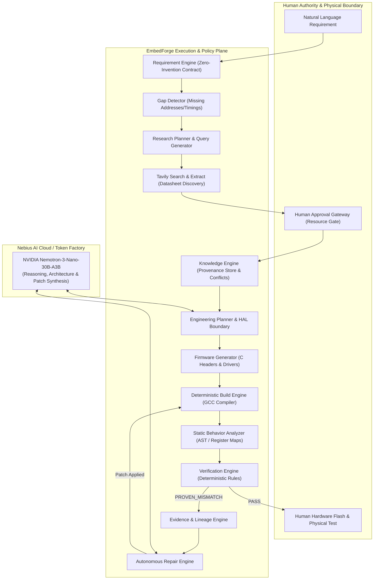

# EmbedForge

[](LICENSE)
[](pyproject.toml)
[](https://studio.nebius.ai/)
[](https://tavily.com/)

> **EmbedForge** is an autonomous, evidence-driven AI embedded engineering system. It transforms human embedded-system requirements into verified, buildable firmware through bounded technical research, human-in-the-loop truth promotion, deterministic behavior extraction, rule-based verification, and autonomous repair loops.

---

## 1. System Architecture

Unlike simple prompt-to-code chatbots, EmbedForge operates as an **autonomous closed-loop engineering pipeline**:



---

## 2. Core Non-Negotiable Principles

1. **Human Authority**: The human engineer decides which external resources become trusted engineering knowledge.
2. **Zero Invention Contract**: The Requirement Engine never invents MCU models, I2C addresses, sampling frequencies, register offsets, pin mappings, or voltages. If missing, they are flagged as `InformationGap` items.
3. **Deterministic Verification**: LLMs provide reasoning, while deterministic parsers and AST extractors extract actual code behavior and verify against approved facts.
4. **Complete Traceability**: Every finding, claim, and patch has an end-to-end lineage trail (`REQ-xxx` $\rightarrow$ `RES-xxx` $\rightarrow$ `KNOW-xxx` $\rightarrow$ `PLAN-xxx` $\rightarrow$ `FW-xxx` $\rightarrow$ `BUILD-xxx` $\rightarrow$ `BEHAV-xxx` $\rightarrow$ `FIND-xxx` $\rightarrow$ `CASE-xxx` $\rightarrow$ `PATCH-xxx`).
5. **Physical Hardware Boundary**: Physical flashing and testing remain under human control.

---

## 3. Technology Stack & Integrations

### A. Nebius Token Factory & NVIDIA Nemotron
- **Model**: `nvidia/NVIDIA-Nemotron-3-Nano-30B-A3B`
- **Endpoint**: `https://api.studio.nebius.ai/v1`
- **Role**: High-reasoning cognitive brain for:
  - Engineering architecture planning and HAL interface partitioning.
  - Root-cause reasoning over verification evidence cases.
  - Minimal patch synthesis.

### B. Tavily Search & Extract Integration
- **Role**: Automated, bounded discovery of official datasheets, register maps, and silicon errata.
- **Features**:
  - Domain-scoped searches prioritizing official semiconductor manufacturers (`st.com`, `ti.com`, `invensense.tdk.com`, `bosch-sensortec.com`, `nordicsemi.com`).
  - Automated extraction of register addresses (`WHO_AM_I`, `PWR_MGMT_1`, `SMPLRT_DIV`), maximum bus clock speeds, and startup delays.
  - Human review gateway ensuring no third-party snippet is promoted to the Knowledge Base without approval.

---

## 4. Reference Repositories (Study, Don't Clone)

| Repository | Focus Area | Architectural Pattern Studied |
| :--- | :--- | :--- |
| [NVIDIA NeMo Agent Toolkit](https://github.com/NVIDIA/NeMo-Agent-Toolkit) | Orchestration & Tools | Policy-governed tool execution sandboxing |
| [NVIDIA Nemotron](https://github.com/NVIDIA-NeMo/Nemotron) | Reasoning Brain | Structured tool calling and reasoning recipes |
| [Embedded AI Workspace](https://github.com/atillab1/embedded-ai-workspace) | Firmware QA & MCP | Datasheet tooling, static analysis, and HIL validation |
| [LUXAR](https://github.com/neltharion11/luxar-embedded-agent) | Autonomous Agent Loop | Embedded lifecycle loop and human approval gates |
| [Datasheet-to-Driver](https://github.com/livia0194/datasheet-to-driver) | Knowledge Extraction | Converting structured register tables into HAL drivers |
| [Embedder CLI](https://github.com/embedder-dev/embedder-cli) | Build & Debug Agent | Deterministic log parsing and iterative compilation |

---

## 5. Quickstart & Installation

### Prerequisites
- Python 3.10+ (tested on Python 3.14)
- Git & Virtualenv

### Installation

```bash
# Clone the repository
git clone https://github.com/your-username/embedforge.git
cd embedforge

# Create and activate virtual environment
python -m venv .venv
source .venv/bin/activate  # On Windows: .\.venv\Scripts\activate

# Install EmbedForge in editable mode
pip install -e .
```

### Environment Configuration

Create a `.env` file in the project root:

```ini
# Nebius AI Cloud / Token Factory
NEBIUS_API_KEY=your_nebius_api_key_here
NEBIUS_BASE_URL=https://api.studio.nebius.ai/v1
NEBIUS_MODEL=nvidia/NVIDIA-Nemotron-3-Nano-30B-A3B

# Tavily AI Search (Optional: uses high-fidelity technical fixtures if unset)
TAVILY_API_KEY=your_tavily_api_key_here
```

---

## 6. Running EmbedForge

### Run Nominal Autonomous Engineering Pipeline
```bash
python -m embedforge.cli --prompt "Create an STM32 driver for MPU6050 accelerometer over I2C at 100Hz with 30ms startup delay." --inject-defect NONE
```

### Run Autonomous Verification & Repair Loop
Inject a known hardware mismatch (e.g. incorrect I2C address `0x77` instead of datasheet `0x68`) to observe autonomous detection, evidence building, patching, and reverification:
```bash
python -m embedforge.cli --inject-defect WRONG_I2C_ADDRESS
```

### Launch Interactive Web Dashboard & Control Plane
Run the local FastAPI dashboard:
```bash
python -m embedforge.server
```
Then navigate to **`http://localhost:8000`** in your browser to interact with:
* Real-time pipeline execution & live Tavily search stream.
* Interactive Human Approval Gate.
* C Code viewer with syntax highlighting and patch diffs.
* Physical Hardware Boundary & Errata Diagnostic Engine.
* Benchmark Scorecard with live metrics.

---

### Run Benchmark Scorecard Evaluation
```bash
python -m embedforge.benchmark.runner
```

---

### Run Test Suite
```bash
pytest -v
```

---

## 7. License

EmbedForge is open-source software licensed under the [Apache License 2.0](LICENSE).
