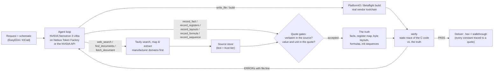

# EmbedForge

[](LICENSE)
[](pyproject.toml)
[](https://tokenfactory.nebius.com/)
[](https://tavily.com/)

**EmbedForge turns a component's datasheet into a checked specification, has an AI agent write the driver, and
catches datasheet-level bugs in that driver before any board or simulator exists.**

An NVIDIA Nemotron agent researches the datasheet (with Tavily), records what it needs as facts that must be quoted
word for word from the source, writes the firmware and compiles it with the real vendor toolchain. Then `verify`
reads the C code without running it, works out exactly what it would send to the chip, and compares that with the
recorded datasheet facts. Any difference is an error with a file and line, and goes back to the agent to fix.

---

## Why

Driver bugs that come from misreading a datasheet — the wrong byte order of a calibration value, a reserved bit
set in a config register, a reset delay that is too short, a measurement enabled before the chip is configured —
compile cleanly and usually surface on the bench, with a logic analyser, days later. AI coding agents make exactly
these mistakes, and confidently. Other agents for firmware check their output by flashing a board or running a
circuit simulator. EmbedForge checks it against the datasheet itself, statically, so these bugs are caught at the
desk.

## How it works



1. **Research.** `web_search` runs a Tavily search (manufacturer domains preferred, full page kept as Markdown);
   `find_documents` maps a vendor's product page with Tavily Map to find its official datasheet and errata;
   `fetch_document` reads web pages with Tavily Extract and converts PDFs to Markdown locally (tables and equations
   kept). Sources get a trust tier: manufacturer domains and official GitHub organisations are authoritative; forums
   and mirrors are recorded but flagged.
2. **The truth layer.** Every fact the firmware relies on is recorded with a quote. A fact is accepted only if the
   quote appears verbatim in the stored source (ignoring layout, case and quote marks, on word boundaries), the value
   appears inside the quoted text, and its unit matches the one the source states. Register maps (fields and named
   values), byte layouts, burst-read rules, conversion formulas and datasheet init sequences are recorded the same
   way. Pins come from the imported schematic, quoting its connectivity lines.
3. **Build.** The agent writes the firmware and builds it with PlatformIO (or Betaflight's own build in WSL).
4. **Verify.** A static tracer (`embedforge/truth/flow.py`) walks the code from its entry points — pico-sdk, Arduino
   Wire/SPI, STM32 HAL, ESP-IDF (new and legacy drivers) and Zephyr bus calls; macros, structs, register tables,
   pointers, FreeRTOS tasks and delays — and records the bus traffic: `write 0x7E <- 0xB6`, `delay 2000 us`,
   `read 0x31 x21`. `verify` compares that trace with the truth:

| Compared | Bug it catches | Error code |
|---|---|---|
| Constants vs. facts | A made-up or untagged address, register or chip ID | `UNSOURCED_CONSTANT`, `FACT_VALUE_MISMATCH` |
| Register writes vs. register map | A register the map does not have; a reserved bit set | `REG_UNMAPPED`, `REG_RESERVED_BITS` |
| Event order vs. init sequence | Measurement enabled before configuration; a missing reset | `FLOW_ORDER`, `FLOW_STEP_MISSING` |
| Written values vs. sequence | Forced mode written where normal mode is required | `FLOW_VALUE_MISMATCH` |
| Waits vs. required time | `vTaskDelay(pdMS_TO_TICKS(2))` at 100 Hz waits 0 ticks | `FLOW_DELAY_SHORT` |
| Byte assembly vs. layout | MSB and LSB swapped | `LAYOUT_SHIFT` |
| Burst reads vs. datasheet | Data registers read in two transactions | `REG_BURST_SPLIT` |
| Code math vs. formula (run on probe register bytes) | 2^30 mistyped, exponent sign flipped, wrong signedness | `FORMULA_MISMATCH`, `FORMULA_MISSING` |
| Code it cannot follow | A bus call the tracer does not model | `FLOW_OPAQUE_BUS` |
| Pins in calls vs. schematic and chip | `setSDA(17)` on the SCL pin; `Wire1` on GPIO16 (an I2C0 pin) | `PIN_ROLE_MISMATCH`, `PIN_CAPABILITY` |
| Settings vs. datasheet rules, after every write | Normal mode entered while the 200 Hz default ODR cannot fit the conversion | `CONSTRAINT_VIOLATED` |
| Reading vs. what the code depends on | The Normal mode / Data ready sections never read; a rule in them never settled | `DATASHEET_UNREAD`, `REQUIREMENT_OPEN` |
| Figures in those sections (warning) | The BMP388's normal-mode timing diagram never transcribed; `read_figure` renders the PDF page for Nemotron 3.5 Super VL | `FIGURE_UNREAD` |
| Robustness | `while (!Serial)` with no timeout; a bus status ignored; a failure branch returning success | `UNBOUNDED_WAIT`, `RESULT_IGNORED`, `FAILURE_AS_SUCCESS` |
| Compiler and static analysis | Uninitialised use, shift overflow (GCC `-Wall -Wextra`); cppcheck defects; MISRA C:2012 | `COMPILER_WARNING`, `STATIC_ANALYSIS`, `MISRA_C` |

Code that verify cannot check fails; it never passes silently. The IDE shows the evidence: every constant traced
to its fact and quote, each datasheet sequence step by step, and each register write decoded into its fields.

## Does verify work? The benchmark

`embedforge/verifybench` checks the checker, with no LLM involved. It uses a fictional barometer, the DM388 (a
datasheet written for the benchmark, so the right answer is known exactly), records its truth through the same
gates the agent uses, and verifies a correct driver written for 9 frameworks and in 21 C styles, plus the same
drivers with one planted bug each:

| Measure | Result |
|---|---|
| Correct drivers passing | 30 of 30 |
| Planted bugs caught (one per run) | 673 of 673 |
| Code verify cannot check, blocked instead of passed | 6 of 6 |

With zero misses in 673 runs, the 95% upper bound on the miss rate for bugs of these kinds is about 0.45% (rule of
three, 3/n). Run it yourself — it is offline and free:

```bash
python -m embedforge.verifybench          # add -v to list every planted bug and the error that caught it
```

**On every delivered driver too.** When a run finishes verified, a mutation test plants realistic faults in the
delivered code one at a time (a datasheet constant with a bit flipped, a pin moved, `/` for `*`, a byte in the wrong
place, the wrong signedness, a required delay deleted, a write to the next register, a check inverted, a failure
reported as success) and the delivery report gives the score and lists each fault verify did not catch. On the
BMP388 driver Nemotron wrote for an RP2350B board: 48 of 49 caught (98%); the survivor is listed
(`python -m embedforge.truth.mutate <project dir>`).

**A bug verify caught in Nemotron's own driver.** The first BMP388 driver set normal mode before its oversampling
and data rate. It compiled, and its register values were right; only the order was wrong. Once the datasheet's
conversion-time rule was on record (a constraint over the register fields: conversion time from `OSR.osr_p`,
`OSR.osr_t` against the sampling period from `ODR.odr_sel`, checked after every register write), verify reported
`CONSTRAINT_VIOLATED` at the `PWR_CTRL` write: normal mode entered while the oversampling was still at its reset
x4 and the data rate at 200 Hz, so a measurement (10.9 ms) cannot fit the 5 ms period. Nemotron moved the mode write
last; the rule now holds after each of the driver's 5 writes and verify passes. Getting there also showed where
Nemotron 3 Super satisfied the letter of the gates without the substance (a constraint with the fields multiplied by
0, an order quoted from "in order to"); each of those is now refused.

**On a vendor's own driver.** The benchmark is ours; a correct driver someone else wrote is a harder test. We ran
verify on Bosch's official BMP3 driver (`bmp3.c` from [BMP3_SensorAPI](https://github.com/boschsensortec/BMP3_SensorAPI),
with a small Arduino glue file in the style of Bosch's examples) against the datasheet truth Nemotron recorded for
the BMP388:

- The tracer follows Bosch's function-pointer interface (`dev->read`, `dev->write`) and its calibration parsing,
  and Bosch's temperature compensation matches the datasheet formula on probe input.
- It flags a real defect in Bosch's code: `bmp3_soft_reset()` tests the error register with `BMP3_REG_CMD`
  (`0x7E`, the command register's *address*) as the bit mask, where the `cmd_err` bit (bit 1) was meant; the mask
  also catches `conf_err` and four reserved bits (`REG_MASK_UNDEFINED`).
- 72 findings are traceability, by design: Bosch's constants carry no quote, so verify reports them as untagged or
  unsourced. That is the rule for code EmbedForge delivers, not a claim that the values are wrong.
- One false positive remains: the probe's random calibration bytes put the temperature at 165 °C; Bosch clamps it
  to 85 °C (correctly) before compensating pressure, so the pressure formula is not matched on that input.
- The check also found three tracer bugs, now fixed (a pointer declared to a nested struct member, a callback
  compared with `NULL`, struct members value-initialised in a constructor).

This is one vendor driver, not a false-positive rate; more are needed before quoting one.

**A second part, run cold.** To check that EmbedForge is not tuned to one datasheet, Nemotron 3 Ultra wrote a TI
TMP117 driver from the task alone (no schematic, no stored datasheet, no harness changes during the run): it found
TI's datasheet with Tavily (search, map, extract: 10 credits), recorded the pins, address, IDs and conversion, and
built the driver. It did not pass verify, and the run showed two gaps, both general: TI writes hex as `0Fh` / `00h`,
which the fact gate did not match (fixed since), and the TMP117 has 16-bit registers, which verify did not model.
It does now: a register is recorded with its width and the datasheet's sentence on byte order ("Register bytes are
sent with the most significant byte first"), and verify reads the code's two-byte writes and reads as 16-bit values.
On top of the 8-bit checks this catches bytes put together swapped, a register written or read in half, and a
16-bit measurement read with the wrong sign.

**The TMP117 fix-up.** The same project was then resumed on Nemotron 3 Ultra with one message ("the verifier has
been updated; run verify and fix what it reports"), no new Tavily calls and no change to the driver code. Unaided,
Nemotron re-recorded the three registers as 16-bit with TI's byte-order sentence, the configuration fields, the
temperature layout (signed) and formula, and the power-up sequence. It took four short runs, stopped in between to
load harness fixes for gaps each one exposed, all general:

- a 16-bit register listed twice in a layout (`['0x00', '0x00']`) made a 32-bit value: now refused;
- the candidate quotes offered for a rejected register missed TI's field tables (`01h` addresses, `BIT FIELD`
  headers, a page printed as one line): fixed;
- TI states the conversion as "One LSB equals 7.8125 m°C" or names the value "TEMPERATURE REGISTER VALUE": a number
  with a unit prefix now counts in base units and a value named in words can be bound, after the model had fallen
  back to Adafruit's library header, which a formula may no longer be quoted from while the datasheet is on record;
- the probe gave the ID register a random value when a layout covered it, so the driver stopped at its ID check and
  the formula was never compared with the code (verify had passed): fixed, and a part that never gets measured on
  healthy datasheet values is now an error;
- the I2C address was recorded as TI prints it, in binary (`1001000`), and read as decimal, so verify never asked for
  the init sequence: fixed.

Result: verify PASS (Configuration 0x01 <- 0x0220 decodes as MOD=0 continuous, CONV=4, AVG=1; the temperature formula,
quoted from TI's datasheet, matches the code on probe input; the 1.5 ms power-up wait is met by the code's 2 ms).
Mutation test: 19 of 25 planted faults caught. The six survivors: four sign changes that alter no value, one
(`int8_t buffer[2]` passed as `uint8_t*`) that would not compile, and a flip of TI's unused bit 0, which verify
reports as a reserved-bit warning. The first mutation test of this driver (13 of 25) is what exposed the last two
gaps above, and two more checks: a wrong device ID or an object never set up, reported as success, is now
`FAILURE_AS_SUCCESS`.

## NVIDIA Nemotron on Nebius Token Factory

- **Default model:** `nvidia/Nemotron-3-Ultra-550b-a55b` on Nebius Token Factory (OpenAI-compatible API). In our
  runs the larger Nemotron models (Super, Ultra, 3.5 Lightning) reached verified Betaflight board configs, while
  Nano (3B active) mostly looped in research (1 of its 8 runs ended verified; see the table below). The model picker
  lists every chat model the provider offers, Nemotron first.
- **Sampling and chat template** follow the Nemotron 3 model card: temperature 1.0, top_p 0.95, and
  `chat_template_kwargs = {enable_thinking: true, force_nonempty_content: true}`, NVIDIA's setting for coding agents
  and tool calling (`EMBEDFORGE_NEMOTRON_EFFORT=medium` adds `medium_effort` for shorter reasoning; a provider that
  rejects the options is used without them). Replies get up to 16k output tokens; reasoning arrives in
  `reasoning_content` (or inline `<think>`) and is shown live in the IDE.
- **Datasheet search** (`search_datasheet`): a long datasheet is split along its sections, embedded once with
  NVIDIA's Nemotron Embed (`nvidia/nemotron-3-embed-1b`) and cached with the project; a question returns the passages
  that answer it. On the BMP388 datasheet, "conversion time for x8 pressure oversampling" ranks 3.9.1 Measurement
  time first and "settings recommended for a drone" 3.5 Filter selection (Table 10); indexing took 8 s, each search
  under 1 s.
- **Figures** (`read_figure`): timing diagrams and mode transitions are drawn, so text extraction loses them; the
  figure is cut from its PDF page and transcribed by Nemotron 3.5 Super VL (`nvidia/nemotron-3.5-super-vl-120b-a12b`).
- **Tool calling** uses the OpenAI `tools` schema. Calls the model writes as text (Qwen-coder XML, Hermes JSON or
  bare JSON) are recovered and run; replies cut off at the token limit are retried instead of shown.
- **Your own GPUs:** [`deploy/nebius-vm/`](deploy/nebius-vm/README.md) serves Nemotron 3 Super with vLLM on a Nebius
  AI Cloud GPU VM (`SELFHOSTED_BASE_URL`) and runs the IDE next to it, reachable from any browser with a password.
- **Provider order:** self-hosted → Nebius Token Factory (Nemotron) → NVIDIA API catalog (Nemotron) → Claude →
  Gemini, whichever is configured first; `EMBEDFORGE_PROVIDER` forces one.

### Where our runs ran

Every run records its provider, model, harness version, and each step's tokens and model time in the project's
`trace.jsonl`, so this table is generated, not written (`python -m embedforge.runlog --markdown`; `--runs` lists each
run). Snapshot of 20 October 2026:

| Provider | Model | Runs | Ended built + verified | Steps (median per run) | Prompt + completion tokens | Model time per step |
|---|---|---|---|---|---|---|
| Nebius Token Factory | `nvidia/Nemotron-3-Ultra-550b-a55b` | 47 | 3 | 1611 (36) | 59.7M + 735k | 5 s |
| Nebius Token Factory | `nvidia/nemotron-3-super-120b-a12b` | 8 | 1 | 412 (60) | 8.8M + 294k | 6 s |
| Nebius Token Factory | `nvidia/Nemotron-3_5-Lightning` | 6 | 2 | 313 (58) | 8.5M + 124k | 4 s |
| Nebius Token Factory | `nvidia/NVIDIA-Nemotron-3-Nano-30B-A3B` | 8 | 1 | 150 (7.5) | 1.8M + 230k | 12 s |
| NVIDIA API | `nvidia/nemotron-3-ultra-550b-a55b` | 18 | 9 | 426 (13.5) | 18.7M + 180k | 20 s |
| NVIDIA API | `nvidia/nemotron-3-super-120b-a12b` | 18 | 3 | 758 (38.5) | 42.8M + 923k | 93 s |

Read it with care: the runs are not a controlled comparison. Most of the 47 Token Factory Ultra runs were
development runs on one day while the harness changed between them, the tasks differ (Betaflight board configs,
sensor drivers), and "ended built + verified" counts a run's own end state, not task difficulty. Two things hold
across them: the agent prompt is about 20–55k tokens per step, so context size drives cost; and Token Factory served
Nemotron 3 Ultra at about 5 s of model time per agent step, against about 20 s on NVIDIA's API with prompts of the
same size.

EmbedForge was built and evaluated on Nebius Token Factory: 69 runs over four Nemotron models, including verified
drivers and board configs from Ultra, Super and 3.5 Lightning. Our Token Factory credits ran out on 9 October, so
the later runs, including the BMP388 rehearsal above, use the **same Nemotron 3 Ultra model through NVIDIA's API**.
Nothing in the code depends on which of the two serves it: with a `NEBIUS_API_KEY` in `.env` the IDE uses Token
Factory again (it comes first in the provider order), and `deploy/nebius-vm/` runs Nemotron on a Nebius AI Cloud
GPU VM instead.

## Tavily: it finds, the ledger verifies

Every fact EmbedForge relies on is quoted from text Tavily found, mapped or extracted, so Tavily is the start of the
evidence chain:

| Step | Tavily endpoint | How it is used |
|---|---|---|
| Find | **Search** (`search_depth="advanced"`, `chunks_per_source=3`) | Manufacturer domains preferred (`include_domains_mode="prefer"`), quoted part numbers matched exactly (`exact_match`), the whole page kept as Markdown (`include_raw_content="markdown"`) so register tables stay tables and every quote can be checked against it; relevance `score` passed to the agent |
| Discover | **Map** (`instructions`, `max_depth=2`, no external links) | `find_documents` maps the part's product page for the vendor's own datasheet, reference manual, register map and errata, PDFs and the part's own documents first |
| Read | **Extract** (`extract_depth="advanced"`, `format="markdown"`) | Web pages are read through Extract (rendered, tables kept); PDFs are converted locally first, Extract as the fallback |
| Verify | — | The fact ledger accepts a fact only if its quote is verbatim in that stored text |

Every call asks for its usage (`include_usage`) and is logged with its `request_id` and credits, and each stored
source keeps the endpoint and request that produced it. The IDE shows them per source, and the delivery walkthrough
lists, for every fact, the Tavily request that found its source and the credits spent per datasheet fact. Searches
are cached per run, and a research budget stops endless searching (6 searches without a new fact or code change).
`TAVILY_SEARCH_DEPTH=basic` halves the search cost, and `EMBEDFORGE_TAVILY_MAX_CALLS` (default 12) caps the searches
and maps one run may make; past it the agent works from the sources it has stored.

## Quickstart

Requirements: Python 3.10+. PlatformIO is installed as a dependency and downloads each project's toolchain on first
use. Betaflight builds need Windows with WSL (Ubuntu).

```bash
git clone https://github.com/Toy-tusk7/embedded_force.git
cd embedded_force
python -m venv .venv
source .venv/bin/activate          # Windows: .\.venv\Scripts\activate
pip install -e .
pip install -e ".[pdf]"            # optional: better PDF -> Markdown (PyMuPDF, AGPL-3.0)
cp .env.example .env               # then add NEBIUS_API_KEY and TAVILY_API_KEY
embedforge                         # or: python -m embedforge.server
```

To host the IDE for others (a demo on a cloud VM), set `EMBEDFORGE_PASSWORD` and `EMBEDFORGE_HOST=0.0.0.0`: the
browser asks for the password (any user name), and the server refuses to listen beyond the local machine without one.

Open **http://localhost:8000** and describe the firmware, e.g. *"Raspberry Pi Pico (pico-sdk), BMP388 on I2C0
(SDA GP4, SCL GP5, SDO to GND): read temperature and pressure every second over USB serial."*

### The IDE

- **Pipeline** — Understand → Target → Research → Facts → Code → Build → Verify → Deliver, live per run, with a run
  health panel that says where a run is stuck.
- **Conversation** — the agent's reasoning and tool calls, grouped into readable activity blocks.
- **Workspace** — files (FACT tags link to their quote), the fact ledger with quotes and trust tiers, sources,
  versioned builds (`.hex` / `.bin` / `.elf`), Checks (compiler errors, verify findings, sequences, register meaning,
  traceability) and a terminal.

### Import your schematic

Click **EasyEDA** in the composer and drop your exports:

| Editor | Best file | Optional extras |
|---|---|---|
| EasyEDA Pro | `File › Save As (Local)` → `.epro` / `.epro2` | `File › Export › Netlist`, `File › Export › Bill of Materials` (CSV) |
| EasyEDA Standard | `File › EasyEDA File Source…` → `.json`, or the project `.zip` | `File › Export Netlist`, BOM CSV |

KiCad netlists (`.net`) work too. Netlists give connectivity, the schematic gives pin names, the BOM gives part
numbers. The agent reads the board with `query_board` and records each pin it uses as a fact quoting the exact
connectivity line (e.g. `U1 pin 29 (PA8) -> net HIN_A -> U2.3 (HIN1)`).

### Build targets

| Firmware | How it builds | Notes |
|---|---|---|
| Custom firmware (STM32, ESP32, AT32, RP2040, …) | PlatformIO, project-local core | Boards from the PlatformIO registry; ArteryTek AT32 installed automatically |
| Custom firmware for RP2350 / RP2354 | PlatformIO + [`maxgerhardt/platform-raspberrypi`](https://github.com/maxgerhardt/platform-raspberrypi) | Community platform; RP2354A/B = RP2350A/B with 2 MB stacked flash |
| Betaflight board configs | Betaflight `2026.6.2` + its toolchain in **WSL** (`make CONFIG=<BOARD>`) | The agent writes `config.h` from the schematic; every pin is checked against the schematic and the RP2350 pin tables |

### Guard-rails

- **No fake targets.** MCUs are resolved against the real PlatformIO registry; anything else is reported as
  unsupported rather than built for another chip.
- **Budgets that follow progress.** 6 searches or 10 SDK lookups without a new fact or code change block further
  searching with a concrete next step; a run gets 60 steps, extended by 30 (up to 3 times) while it is still making
  progress, and pauses after 28 steps without progress.
- **Runs survive a stopped server.** Records are written to a temporary file and swapped in, so a crash leaves the old
  file or the new one, never half; a file that does not parse is kept aside (`.corrupt`), not overwritten. The
  conversation is saved after every step; a run cut off by a stop is marked interrupted at the next start and
  `continue` resumes it (`EMBEDFORGE_RESUME_INTERRUPTED=1` resumes it automatically).
- **Build sandbox.** The agent cannot write `extra_scripts`, `platform_packages`, `!command` flags, URL `lib_deps`,
  `*.py` or `library.json` — the ways a PlatformIO build can run code on your machine.

## Project layout

| Path | What it does |
|---|---|
| `embedforge/agent/` | The agent loop (`loop.py`), model providers (`llm.py`), tools (`tools.py`), context and prompts |
| `embedforge/truth/` | Sources and PDF → Markdown, the fact ledger, register/sequence books, the static tracer (`flow.py`) and `verifier.py` |
| `embedforge/toolchain/` | PlatformIO and Betaflight (WSL) builds, `.hex` / `.uf2` output |
| `embedforge/eda/` | EasyEDA / KiCad schematic import |
| `embedforge/verifybench/` | The verify benchmark (fictional DM388 datasheet, drivers, planted bugs) |
| `embedforge/server.py`, `embedforge/web/` | FastAPI server and the browser IDE |
| `tests/` | `pytest` (offline: models and Tavily are faked) |

## Limits: what verify checks, and what it does not

Verify is a static comparison of the code's bus traffic and arithmetic with the recorded datasheet truth. A PASS
means no difference was found for the kinds of bug in the table above; it is not a formal proof that the firmware
is correct. Specifically:

- **Not on the board.** It replaces neither a first power-on test nor a logic analyser. It cannot see electrical
  faults (wiring, pull-ups, power, noise, a dead chip), bus-level timing (clock stretching, signal integrity), runtime
  behaviour such as interrupts and concurrency, or chip behaviour the datasheet does not describe (errata).
- **Only as good as the records.** Every fact must be quoted verbatim, and a missing fact makes verify fail instead of
  guess. But a choice the datasheet leaves open (which IIR coefficient Table 10's "2" means, which use-case row fits
  the user) is settled by a record the agent cites, not proven.
- **Formulas on synthetic input.** Conversion formulas are checked by running the code on generated register bytes.
  A driver that clamps an intermediate value to the sensor's physical range can be reported as a mismatch when
  those bytes are out of range (seen on Bosch's pressure compensation).
- **Rules found by wording.** Requirements are the rule sentences of the sections the code depends on, found by
  wording (must, before, wait, at least, ...); a rule phrased otherwise can be missed. Figure transcriptions come
  from a vision model and are not authoritative.
- **Claims are reviewed, not proven.** "Implemented" / "not applicable" claims are checked by a second model call,
  which can be wrong; for timing, the mode in use and the recommended settings a checkable record is required instead.
- **MISRA is partial.** cppcheck's MISRA addon checks a subset of MISRA C:2012, and neither tool is qualified for
  certification. MISRA findings are warnings (advisory for C++ code).
- **Registers at one-byte addresses.** Register-level checks (fields, reserved bits, rules after each write, formulas
  on probe input) model registers of 8, 16, 24 or 32 bits behind a one-byte register pointer, the pointer moving on
  register by register; a wide register needs its byte order quoted. Parts with 16-bit register addresses, or that
  pack several registers into one word, are not modelled at that level.
- **Code it cannot follow fails.** The static tracer follows the SDK calls listed above; other bus calls are
  reported, not trusted.

## Related work

Agents that write firmware and test it on a board ([Embedder](https://www.ycombinator.com/companies/embedder),
[EmbedGenius](https://arxiv.org/abs/2412.09058)) or in a circuit simulator ([EmbedBench](https://arxiv.org/abs/2506.11003)),
and formal tools that prove general properties from hand-written specifications (CBMC, Frama-C, Microsoft SDV).
EmbedForge's difference: the specification is built from the datasheet by the agent, every line of it checked
against the source text, and the code is checked against it before anything runs.

## Tests

```bash
pip install -e ".[dev]"
pytest                                  # offline: models and Tavily are faked
python -m embedforge.verifybench        # the verify benchmark
python -m embedforge.runlog             # which provider and model every recorded run used
```

## License

Apache License 2.0 (see [LICENSE](LICENSE)). The optional `[pdf]` extra installs PyMuPDF / pymupdf4llm, which are
AGPL-3.0 (or commercially licensed); without it, PDFs are read with pypdf.
